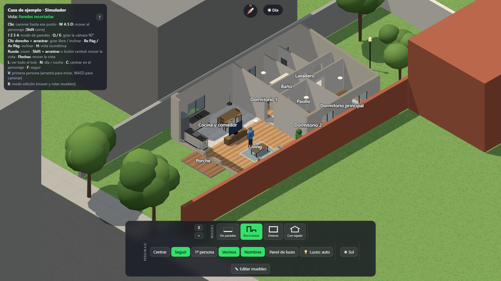
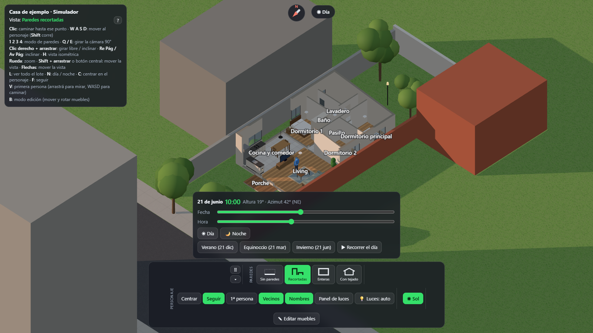
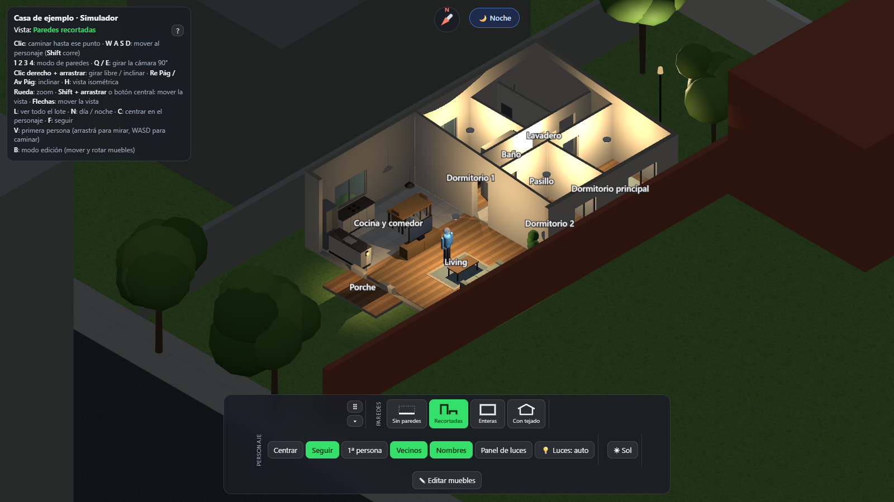
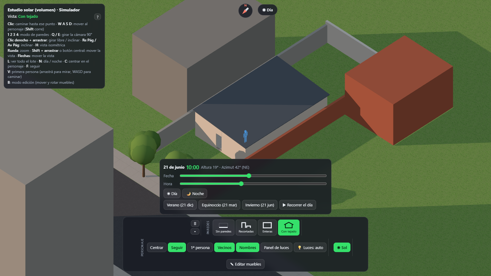

# Demo: simulador 3D de una casa (ficticia)

**Probalo en vivo:** https://casavirtual.vercel.app/ · **Estudio de sol:** https://casavirtual.vercel.app/sol/

Un simulador 3D que corre en el navegador (también en el celular) para **ver una casa antes de construirla**: caminás por adentro, las paredes se bajan para ver los ambientes, el sol y las sombras se mueven según la fecha, la hora y la orientación del terreno, y de noche podés probar las luces.

La casa de esta demo es **ficticia**: las medidas, la ubicación y los vecinos son inventados.

| Casa de día | Sol y sombras en invierno |
|---|---|
|  |  |

| Luces de noche | Estudio de sol (solo terreno y volumen) |
|---|---|
|  |  |

## Qué podés hacer en la demo

- **Caminar la casa:** clic para ir a un punto, `W A S D` para moverte, `V` para primera persona.
- **Cambiar la vista de las paredes:** teclas `1` a `4` (sin paredes, recortadas, enteras, con tejado). `Q` / `E` giran la cámara.
- **Ver el sol:** botón **☀ Sol** → elegí fecha y hora, los solsticios o "recorrer el día". Mirá cómo el edificio de enfrente y los linderos tapan o dejan pasar el sol de invierno.
- **Probar las luces:** botón **Día / Noche** (`N`) y **Panel de luces** para prender o apagar por ambiente.
- **Mover muebles:** **Editar muebles** (`B`) para arrastrar, rotar y estirar, y ver si algo entra o no.
- En `/sol/` está el **estudio de sol**: solo el terreno y una caja con la altura de la casa, para decidir la orientación y qué ambiente va dónde **antes** de dibujar la distribución.

## Cómo se usa para tu propia casa

La demo es solo para mirar. El simulador de **tu** casa lo armás con **`casa-virtual`, un plugin de Claude Code**: no es un programa que se instala y se abre, sino una guía que trabaja dentro de Claude Code. Vos aportás fotos de tus planos (o un boceto, o solo las medidas del terreno) y respondés preguntas; Claude hace el trabajo técnico y te deja el simulador funcionando.

**Qué necesitás:** una suscripción a Claude Code, Python 3 y un navegador actual. No hace falta saber programar ni tener internet para usarlo una vez armado.

**Instalación** (el plugin se instala desde un marketplace de Claude Code; en pruebas):

```
/plugin marketplace add RUTA-O-REPO-QUE-TE-PASEN
/plugin install casa-virtual@casa-virtual-market
```

**Uso:**

```
/casa-virtual:iniciar mi-casa      # te guía de cero hasta el simulador
/casa-virtual:validar              # revisa medidas, aberturas y choques
/casa-virtual:entra dormitorio2 1.4x1.9   # ¿entra una cama de 1,40 × 1,90 en ese ambiente?
```

Podés empezar de tres maneras:

1. **Con planos:** fotos de planta, cortes, fachadas, techos y ubicación con el norte.
2. **Con un boceto:** un dibujo a mano o una lista de ambientes con medidas aproximadas.
3. **Solo con el terreno:** para estudiar el sol primero y decidir la distribución después.

En todos los casos se resuelve primero el sitio y el sol (ciudad, orientación del terreno, vecinos) y recién después la distribución. Claude te pregunta solo lo que los planos no aclaran.

**Cómo conseguir el plugin:** se entrega por invitación (no está publicado en este repo). Si te interesa, abrí un *issue* acá o escribime desde el perfil.

## Alcance y límites

- Modela **una planta**, muros rectos, ambientes rectangulares, techo de **una sola pendiente**, terreno plano y lote rectangular.
- El sol y las sombras son una **aproximación visual**: alturas de vecinos estimadas, sin árboles futuros ni reflejos. **No reemplazan un estudio de asoleamiento profesional ni a un arquitecto.**
- Un modelo hecho desde un boceto sirve para **decidir y comparar**, no para construir. Para construir hace falta un profesional matriculado.

## Licencia

Todos los derechos reservados. Esta demo es una casa ficticia con fines ilustrativos; no se autoriza copiar, redistribuir ni reutilizar el código o los datos sin permiso escrito. Incluye [three.js](https://threejs.org/) (MIT), ver `lib/LICENSE-three.txt`.
